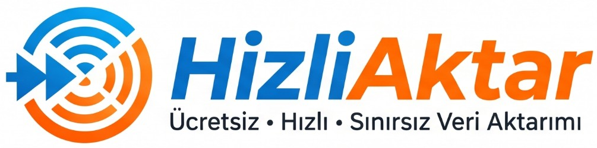
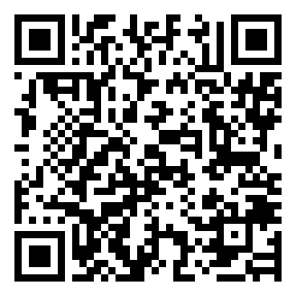
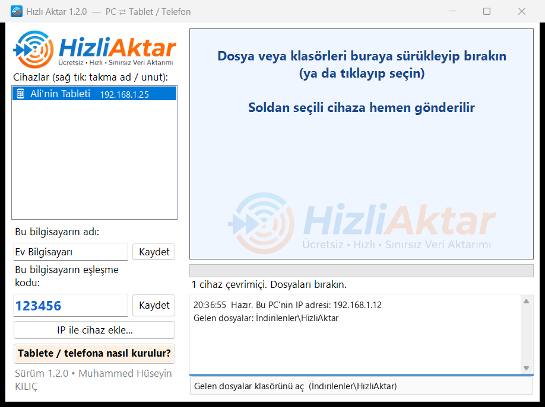
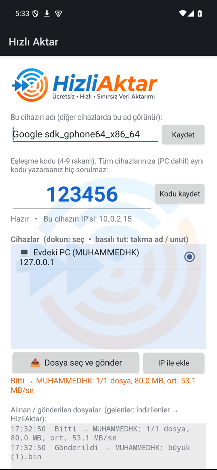
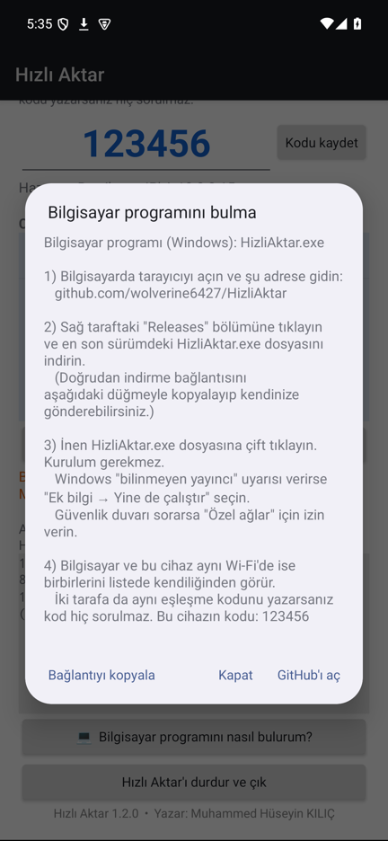

<p align="center">
  
</p>

<p align="center">
  <b>Bilgisayar, tablet ve telefon arasında her yönde kablosuz, ücretsiz, sınırsız dosya aktarımı. Aynı Wi-Fi üzerinden ya da modemsiz doğrudan bağlantıyla.</b><br>
  Sürükle-bırak ile gönder, telefondan "Paylaş" ile geri gönder. İnternet, hesap, bulut ve kablo gerekmez.
</p>

<p align="center">
  <a href="../../releases/latest"></a>
  
  
  <a href="LICENSE"></a>
</p>

<p align="center">Yazar: <b>Muhammed Hüseyin KILIÇ</b></p>

---

## 📥 İndir

| | Dosya | Nereye kurulur | Doğrudan indirme |
|---|---|---|---|
| 💻 | **HizliAktar.exe** | Windows bilgisayar (kurulum yok, çift tıkla çalışır) | [**HizliAktar.exe indir**](https://github.com/wolverine6427/HizliAktar/releases/latest/download/HizliAktar.exe) |
| 📱 | **HizliAktar.apk** | Android tablet / telefon (Huawei MatePad dahil) | [**HizliAktar.apk indir**](https://github.com/wolverine6427/HizliAktar/releases/latest/download/HizliAktar.apk) |



> **Tablete en kolay kurulum:** Yandaki QR kodu tabletin veya telefonun kamerasıyla okutun. APK doğrudan iner.
> Aynı QR kod bilgisayar programındaki **"Tablete / telefona nasıl kurulur?"** düğmesinde de bulunur.

Tüm sürümler: [Releases sayfası](../../releases)

<br clear="right">

---

## 🖼️ Ekran görüntüleri

| Bilgisayar | Tablet / telefon | Tabletteki rehber |
|:---:|:---:|:---:|
|  |  |  |
| Dosyaları mavi alana sürükleyin | Cihaz seçin, dosya gönderin | "Bilgisayar programını nasıl bulurum?" |

<sub>Görüntülerdeki cihaz adları ve adresler örnektir.</sub>

---

## ✨ Neler yapabilir?

- **Çift yönlü:** Bilgisayardan tablete de, tabletten bilgisayara da gönderebilirsiniz. Tabletten tablete veya telefona da çalışır.
- **⚡ Doğrudan bağlantı:** Modem gerekmeden cihazdan cihaza Wi-Fi Direct (Huawei Share / Quick Share yöntemi). Aynı modemden geçmeye göre yaklaşık 2 kat hızlı.
- **Sürükle-bırak:** Dosya ve klasörleri bilgisayardaki pencereye bırakın, hemen gönderilir. Klasör yapısı korunur.
- **Paylaş menüsü:** Tablette Galeri, Dosyalar, WhatsApp gibi herhangi bir uygulamada **Paylaş → Hızlı Aktar**'ı seçin, dosya bilgisayara gitsin.
- **Kendiliğinden bulur:** Aynı Wi-Fi'deki cihazlar, adlarıyla birlikte listede kendiliğinden görünür.
- **Unutmaz:** Bir kez bağlanan cihaz **iki tarafta da** hatırlanır. Kapalıyken listede "çevrimdışı" olarak kalır.
- **Takma ad:** Cihazlara istediğiniz adı verebilirsiniz ("Evdeki PC", "Ali'nin tableti" gibi).
- **Kod bir kez sorulur:** Eşleşme kodu ilk seferde sorulur, sonra hatırlanır. **Tüm cihazlarınıza aynı kodu yazarsanız hiç sorulmaz.**
- **Sınır yok:** Boyut sınırı yoktur (1 KB da olsa 100 GB da olsa gönderebilirsiniz). Hız sınırı da yoktur; ağınız ne kadar hızlıysa o kadar hızlı gider. Yer yetmezse aktarım başlamadan uyarı verilir.
- **Ekran kararmaz:** Tablet uygulaması açıkken ekran kilitlenmez. Bilgisayar da uzun aktarımlarda uykuya geçmez.
- **Kendi içinde rehber:** Bilgisayar programı APK'nın nereden indirileceğini QR kodla gösterir. Tablet uygulaması da bilgisayar programının nasıl bulunacağını anlatır.

---

## 🚀 Kurulum (5 dakika)

### 1. Bilgisayar
1. **[HizliAktar.exe](https://github.com/wolverine6427/HizliAktar/releases/latest/download/HizliAktar.exe)** dosyasını indirin ve çift tıklayın. Kurulum gerekmez.
2. Windows **"Windows bilgisayarınızı korudu"** uyarısı verirse **Ek bilgi → Yine de çalıştır**'a tıklayın. Program imzasız olduğu için bu uyarı normaldir.
3. **Windows Güvenlik Duvarı** sorarsa **Özel ağlar** kutusunu işaretleyip **Erişime izin ver**'e tıklayın.
   > ⚠️ Güvenlik duvarına izin verilmezse tablet bilgisayarı göremez ve bilgisayara dosya gönderemez.

### 2. Tablet / telefon
1. Bilgisayar programındaki **"Tablete / telefona nasıl kurulur?"** düğmesine tıklayın ve çıkan **QR kodu** tabletin kamerasıyla okutun.
   Ya da tablette tarayıcıdan **[HizliAktar.apk](https://github.com/wolverine6427/HizliAktar/releases/latest/download/HizliAktar.apk)** dosyasını indirin.
2. İnen **HizliAktar.apk** dosyasına dokunun. *"Bilinmeyen kaynaklardan yüklemeye izin ver"* sorulursa izin verin ve **Yükle**'ye dokunun.
3. **Hızlı Aktar**'ı açın. Bildirim izni istenirse izin verin.

### 3. Eşleştirme (bir kez)
- Tabletteki **eşleşme kodunu** bilgisayardaki kodla aynı yapın (ya da tersini) ve **Kaydet**'e basın. Böylece kod hiç sorulmaz.
- Farklı kodlar kullanırsanız ilk gönderimde karşı cihazın kodu bir kez sorulur ve sonra hatırlanır.

---

## 📖 Kullanım

### Bilgisayardan tablete
1. Soldaki listeden tableti seçin (çevrimiçi olan ilk cihaz zaten seçilidir).
2. Dosya veya klasörleri mavi alana **sürükleyip bırakın**. Ya da alana tıklayıp dosya seçin.
3. Tablette dosyalar **Dosyalar → İndirilenler → HizliAktar** klasörüne kaydedilir.

> Birden çok cihaz seçerseniz (Ctrl+tıklama) aynı dosyalar hepsine gönderilir.

### Tabletten bilgisayara
- **Yol 1:** Hızlı Aktar'da bilgisayarı seçin, **📤 Dosya seç ve gönder**'e dokunun ve dosyaları seçin.
- **Yol 2:** Galeri, Dosyalar veya başka bir uygulamada dosyayı seçin, **Paylaş → Hızlı Aktar**'a dokunun, ardından açılan ekranda **Gönder**'e basın.

Bilgisayarda dosyalar **İndirilenler\HizliAktar** klasörüne kaydedilir. Penceredeki **Gelen dosyalar klasörünü aç** düğmesi bu klasörü açar.

### Takma ad ve cihazı unutma
- **Bilgisayarda:** Cihaza **sağ tıklayın** → *Takma ad ver* / *Kodu unut* / *Cihazı unut*.
- **Tablette:** Cihazın üzerine **basılı tutun**. Aynı seçenekler çıkar.

---

## ⚡ En hızlı yol: Doğrudan bağlantı (modemsiz)

Aynı Wi-Fi'de her paket önce modeme, sonra modemden karşı cihaza gider; yani havadan **iki kez** geçer. **Doğrudan bağlantıda** (Wi-Fi Direct) cihazlar birbirine tek adımda bağlanır, mümkünse 5 GHz bandında. Bu, Huawei Share ve Google Quick Share'in kullandığı yöntemin kendisidir. Aynı modemden geçmeye göre yaklaşık **2 kat** hızlıdır, Wi-Fi'nin hiç olmadığı yerde de çalışır ve bağlantı WPA2 ile şifrelidir.

**Android ⇄ Android (tablet, telefon; Android 10+):**
1. İki cihazın **eşleşme kodu aynı** olsun.
2. Birinci cihaz: **⚡ Doğrudan bağlantı → Bağlantıyı aç**.
3. İkinci cihaz: **⚡ Doğrudan bağlantı → Bağlantıya katıl**. Onay gerekmez; cihazlar birkaç saniyede listede görünür.
4. Bittiğinde **Bağlantıyı kapat**.

**Bilgisayar ⇄ Android:**
1. Tablette **⚡ Doğrudan bağlantı → Bağlantıyı aç**. Ekranda bir **ağ adı** (`DIRECT-HA-HizliAktar-…`) ve **şifre** görünür.
2. Bilgisayarda Wi-Fi listesinden bu ağa bağlanın ve şifreyi girin. Windows sorarsa ağın **bulunabilir (Özel)** olmasına izin verin.
3. Cihazlar listede görünür. Görünmezse bilgisayarda **IP ile ekle → 192.168.49.1**.

> Bilgisayar bu ağa bağlıyken internete çıkamaz; aktarım bitince eski Wi-Fi'nize geri dönün.

### Hangi durumda hangi yol en hızlı?

| Cihazlar | En hızlı yol |
|---|---|
| Telefon / tablet ⇄ telefon / tablet | **⚡ Doğrudan bağlantı** |
| Bilgisayar ⇄ telefon / tablet | **⚡ Doğrudan bağlantı** (PC ağa katılır). Bilgisayar modeme **kabloyla** bağlı ve modem 5 GHz/Wi-Fi 6 ise aynı Wi-Fi de neredeyse aynı hızdadır. |
| Bilgisayar ⇄ bilgisayar | İkisi de modeme **kabloyla** bağlıyken (100–1000 Mbit kabloyla 11–110 MB/sn). Kablo yoksa aynı Wi-Fi. |
| Wi-Fi olmayan yer | **⚡ Doğrudan bağlantı** |

Hangi yolu seçerseniz seçin protokol aynıdır: 4 paralel TCP bağlantısı, 1 MB tamponlar ve hız sınırı yok. Hızı belirleyen tek şey, cihazlar arasındaki bağlantının kendisidir.

---

## 🛠️ Sorun giderme

| Sorun | Çözüm |
|---|---|
| Cihaz listede görünmüyor | İki cihaz **aynı Wi-Fi ağında** mı? Misafir ağlar cihazların birbirini görmesini engeller. Tablette Hızlı Aktar açık mı? |
| Tablet bilgisayarı görmüyor ama bilgisayar tableti görüyor | Bilgisayarda Windows Güvenlik Duvarı'nda Hızlı Aktar'a **Özel ağ** izni verin: *Denetim Masası → Windows Defender Güvenlik Duvarı → Bir uygulamaya izin ver*. |
| Hâlâ görünmüyor | **IP ile ekle** düğmesine basın ve karşı cihazın IP adresini girin. Tabletin IP'si Hızlı Aktar ekranında, bilgisayarın IP'si penceredeki kayıtta yazar. |
| "Kod yanlış" | Karşı cihazın ekranındaki kodu girin. Kolaylık için tüm cihazlara aynı kodu yazın. |
| "Bu adreste bulunamadı" | Cihazın IP adresi değişmiş olabilir. Cihazda Hızlı Aktar'ı açın; birkaç saniye içinde yeni adres kendiliğinden öğrenilir. |
| Huawei / Honor arka planda kapatıyor | *Ayarlar → Pil → Uygulama başlatma → Hızlı Aktar → Manuel yönet* yolunu izleyin ve üç seçeneği de açın. |
| APK kurulmuyor | **HarmonyOS NEXT / 5.x** Android uygulamalarını (APK) çalıştırmaz. Diğer cihazlarda bilinmeyen kaynaklara izin verildiğinden emin olun. |
| Yavaş | **⚡ Doğrudan bağlantı** kullanın. Aynı Wi-Fi'de kalacaksanız 5 GHz kullanın ve modeme yakın durun. Uygulama hızı kısmaz. |
| Doğrudan bağlantı açılmıyor | Wi-Fi açık mı? Android 12 ve altında **Konum** da açık olmalı. Uygulamanın **Yakındaki cihazlar** / **Konum** izni var mı? Android 9 ve altı desteklenmez. |
| "Bağlantıyı açan cihaz bulunamadı" | İki cihazın eşleşme kodu aynı mı? Kod farklıysa ağ adı da farklı olur. |

---

## 🔧 Teknik ayrıntılar

<details>
<summary><b>Nasıl çalışır? (protokol)</b></summary>

```
 Cihaz A (PC veya tablet)                           Cihaz B
 ┌──────────────────────┐   UDP 47801 yayın     ┌──────────────────────┐
 │ Keşif: dinle+duyur   │ ◄───────────────────► │ Keşif: dinle+duyur   │
 │ Alıcı: TCP 47800     │ ◄──── dosya ───────── │ Gönderici            │
 │ Gönderici            │ ───── dosya ────────► │ Alıcı: TCP 47800     │
 └──────────────────────┘  (4 paralel bağlantı) └──────────────────────┘
```

Her cihaz hem alıcı hem gönderici olarak çalışır.

**Keşif:** Her cihaz 1,5 saniyede bir UDP 47801 portuna (255.255.255.255 ve alt ağ yayın adresine) şunu gönderir:
`HA2|<cihaz-id>|<tcp-port>|<tür: pc / mobil>|<cihaz adı>`
6 saniye boyunca haber alınamayan cihaz "çevrimdışı" sayılır.

**Aktarım:** Dosya başına bir TCP bağlantısı açılır. Sayılar big-endian, metinler `uint16 uzunluk + UTF-8` biçimindedir.

| Alan | Açıklama |
|---|---|
| `HA2` | 3 bayt sihirli değer (`HA1`: 1.0/1.1 biçimi, gönderen alanları yok) |
| kod | int32, alıcının eşleşme kodu |
| gönderen id / ad / tür | Doğru kodla bağlanan gönderen, alıcı tarafında da hatırlanır |
| yol | Göreli yol, `/` ile ayrılmış |
| boyut | int64. `-1` ise *ping* (eşleşme ve kimlik kontrolü) |

Alıcının yanıtı: `K` kabul · `P` kod yanlış · `S` yer yok · (veriden sonra) `D` diske yazıldı.
Ping yanıtı: durum baytı + alıcı id + ad + tür. Gönderici, kayıtlı adreste beklediği cihazın yanıt verdiğini doğrular. Yanıt veren başka bir cihazsa gönderim yapılmaz.

**Hız için:** Ham TCP kullanılır, dosya başına yalnızca küçük bir başlık gönderilir. 1 MB tamponlar, 4 MB soket tamponları ve 4 paralel bağlantı kullanılır. Tablette Wi-Fi güç tasarrufu kapatılır (`WIFI_MODE_FULL_HIGH_PERF`) ve yayınları almak için multicast kilidi alınır.

**Güvenlik:** Kod olmadan dosya kabul edilmez. Gelen yollardaki `..`, sürücü harfi, geçersiz ve ayrılmış adlar (CON, NUL…) temizlenir. Dosyalar yalnızca `İndirilenler/HizliAktar` klasörüne yazılır. Yarım kalan dosya silinir.
⚠️ Trafik **şifrelenmez.** Uygulamayı yalnızca güvendiğiniz ağlarda (ev, okul) kullanın.

**Saklanan bilgiler:**
- **Bilgisayar:** `%APPDATA%\HizliAktar\ben.txt` (bu PC'nin kimliği, kodu ve adı) ve `cihazlar.txt` (hatırlanan cihazlar, kodları, takma adları).
- **Tablet:** Uygulamanın kendi ayarları (SharedPreferences).
</details>

<details>
<summary><b>Kaynak koddan derleme</b></summary>

Gereksinimler: Windows, JDK 17 veya üzeri, Android SDK (`build-tools;35.0.0`, `platforms;android-35`). Gradle veya Android Studio projesi gerekmez.

```powershell
powershell -ExecutionPolicy Bypass -File build.ps1
```

Çıktılar `cikti/` klasörüne yazılır:
- **PC:** Windows'la birlikte gelen `csc.exe` ile derlenir.
- **APK:** `aapt2 → javac → d8 → zipalign → apksigner` adımlarıyla üretilir.

İmza anahtarı (`android/hizliaktar.keystore`) ilk derlemede oluşturulur ve depoya eklenmez.

Simgeler, filigranlar ve QR kodu `assets/kaynak.jpg` dosyasından üretilir:
```bash
pip install pillow qrcode
python assets/make_assets.py
```

```
HizliAktar/
├── pc/                    Windows programı (C#, WinForms)
│   ├── Proto.cs           Protokol, keşif, alıcı, cihaz hafızası, gönderici
│   └── MainForm.cs        Pencere, sürükle-bırak, takma ad menüsü, kurulum rehberi
├── android/               Android uygulaması (Java, ek kütüphane yok)
│   └── src/com/hizliaktar/app/
│       ├── MainActivity.java     Ekran, cihaz listesi, gönderim, paylaş menüsü, rehber
│       ├── ReceiverService.java  Arka plan: alıcı + keşif
│       ├── Sender.java           Gönderici
│       ├── Peers.java            Hatırlanan cihazlar ve takma adlar
│       ├── Prefs.java            Cihaz kimliği, adı, kodu
│       └── BuildInfo.java        Sürüm, yazar, bağlantılar
├── assets/                Logo kaynağı ve üretim betiği
├── docs/                  README görselleri
└── build.ps1              Tek komutla derleme
```
</details>

---

## 📜 Sürüm geçmişi

Son sürüm: **1.3.0**. Tüm değişiklikler için [CHANGELOG.md](CHANGELOG.md) dosyasına bakın.

## ⚖️ Lisans

[MIT](LICENSE) © 2026 **Muhammed Hüseyin KILIÇ**. Ücretsizdir; yazar adı korunarak serbestçe kullanılabilir, paylaşılabilir ve değiştirilebilir.
